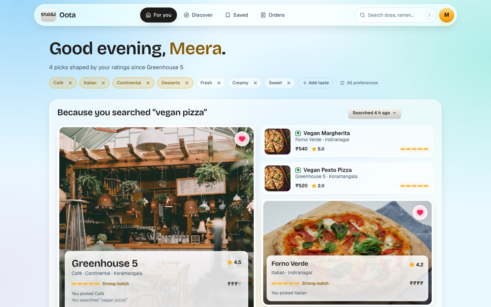

# Oota · ಊಟ

**Personalised food discovery and ordering for Bengaluru — built on PostgreSQL + MongoDB.**
Every diner gets a different home screen, and every recommendation says why it is there.

> DBMS mini-project by **Vrunda** (PES University). All restaurants, people and reviews are fictional demo data.
> Full explainer (schema, ER diagram, every DBMS feature, live-demo script): **[docs/Oota-DBMS-Explainer.pdf](docs/Oota-DBMS-Explainer.pdf)** · Markdown report: [docs/REPORT.md](docs/REPORT.md)



## What it does

| Diners (`/login`) | Restaurant partners (`/partner/login`) | Admin (`/admin/login`) |
|---|---|---|
| Onboarding (cuisines, diet, allergens, spice, flavours) → a personalised, tiered dashboard with reasons · instant search with filters and full-text search · menus with scroll-spy · reviews · save with a like animation · cart (“tiffin”) and ordering with live order status | Self sign-up (pending until approved) · add / edit / price / sell-out dishes with photo upload · reviews and rating distribution · orders: Placed → Preparing → Delivered | Approve restaurants · manage every restaurant, dish, diner and review across both databases · live view of every table and collection |

Change anything in the database from a terminal — insert a dish, delete a restaurant, even `DROP TABLE` — and every open screen updates within a second (Postgres triggers + `NOTIFY`, a DDL event trigger, Mongo change streams → Server-Sent Events).

## Tech

React 19 + TypeScript + Vite + Tailwind v4 + Framer Motion · Node 22 + Express 5 + zod · **PostgreSQL 16** (raw SQL via `pg`: FKs, CHECKs, triggers, event triggers, views, GIN / partial / composite indexes, full-text search, transactions) · **MongoDB 7** (aggregation pipelines, unique compound + TTL indexes, change streams on a replica set) · bcrypt + JWT httpOnly cookies (one per account type) · Docker Compose · Vitest + Supertest + Playwright.

## Run it

```bash
docker compose up -d                                   # PostgreSQL + MongoDB (replica set)
cd backend && npm install && cp ../.env.example .env
npm run reset                                          # schema + realtime triggers + seed both databases
npm run dev                                            # API → http://localhost:4000/api
cd ../frontend && npm install && npm run dev           # app → http://localhost:5173
```

| Account | Email | Password |
|---|---|---|
| Diner (veg, South Indian) | `ananya@oota.demo` | `demo1234` |
| Diner (biryani, kebabs) | `rohan@oota.demo` | `demo1234` |
| Diner (vegan, cafés) | `meera@oota.demo` | `demo1234` |
| Restaurant partner | `<slug>@partner.oota.demo` e.g. `tuppa-and-co@partner.oota.demo` | `demo1234` |
| Admin | `admin@oota.demo` | `demo1234` |

Useful commands: `npm run reset` (rebuild + reseed), `npm run resync` (recompute cached ratings from Mongo), `npm test` (backend: 21 API tests · frontend: recommender tests),
`docker exec -it oota-postgres psql -U oota -d oota`, `docker exec -it oota-mongo mongosh oota`.

## Layout

```
db/postgres/      schema.sql (tables, constraints, triggers, views, indexes) · realtime.sql (NOTIFY + event triggers)
db/seed/          JSON exported from the frontend mock data (npm run export:seed) — the single source of truth
backend/src/      app.ts · modules/{auth,catalog,restaurants,dishes,reviews,preferences,favourites,activity,recommendations,orders,partner,admin,uploads,system}
                  services/{reviewSync,recommender,realtime,catalog,dishes,restaurants} · scripts/{migrate,seed,resync}
frontend/src/     pages/ (diner) · pages/partner · pages/admin · components/ · context/ · api/ · utils/recommend.ts (pure, unit-tested)
docs/             Oota-DBMS-Explainer.pdf · REPORT.md · queries.sql · index-demo.sql · transaction-demo.sql · mongo-demo.js · screenshots/
```

Photography from [Unsplash](https://unsplash.com).
