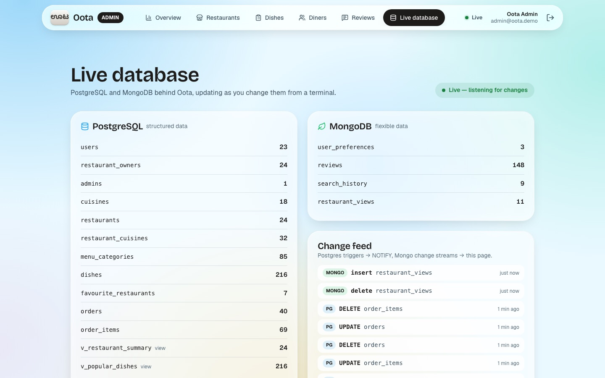
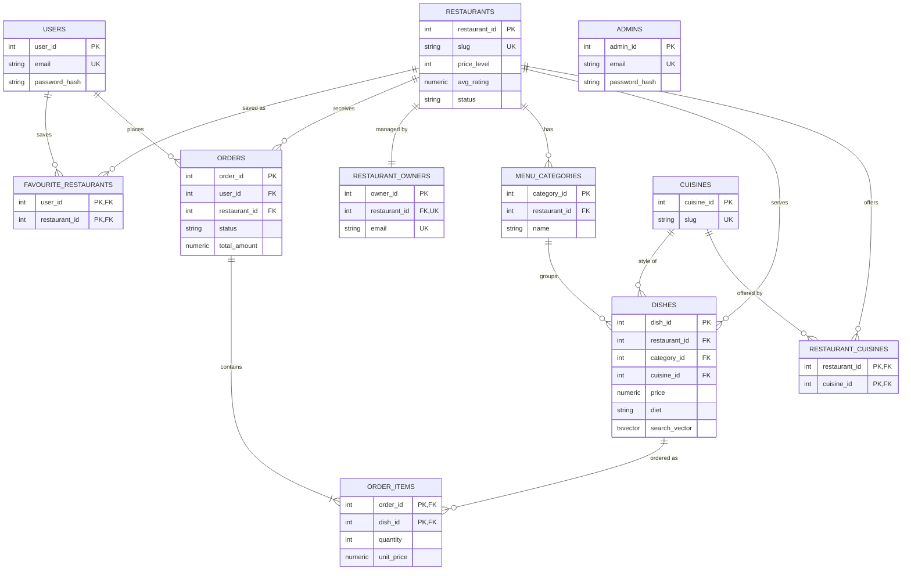
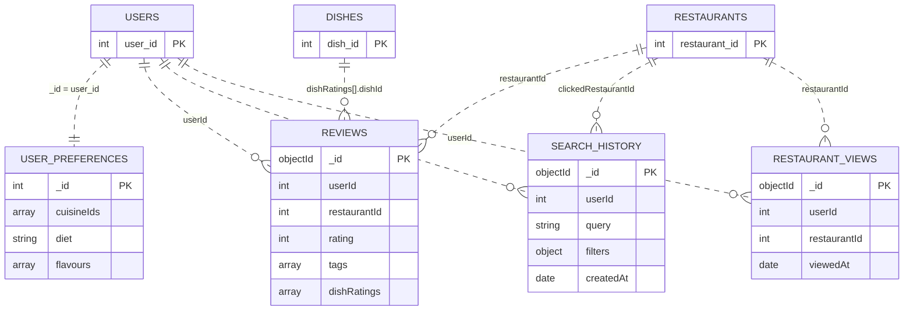
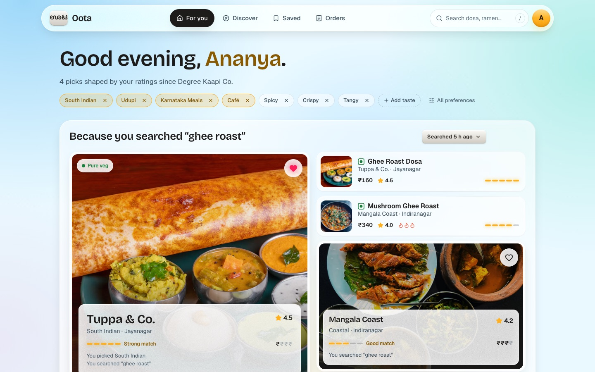
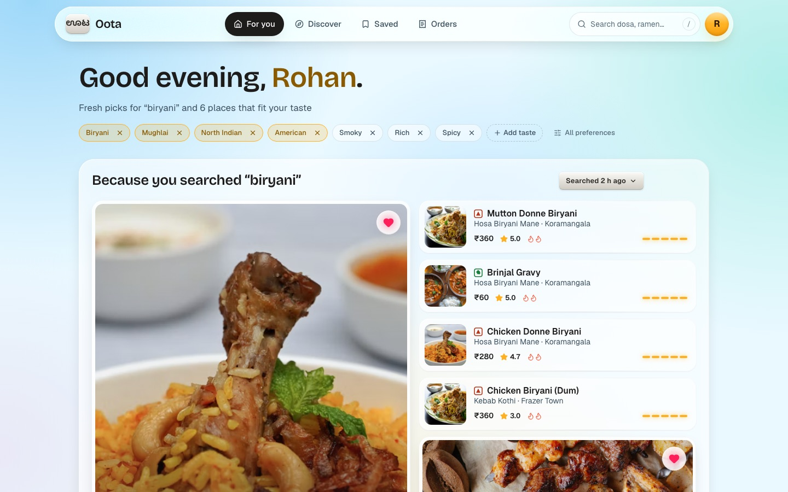
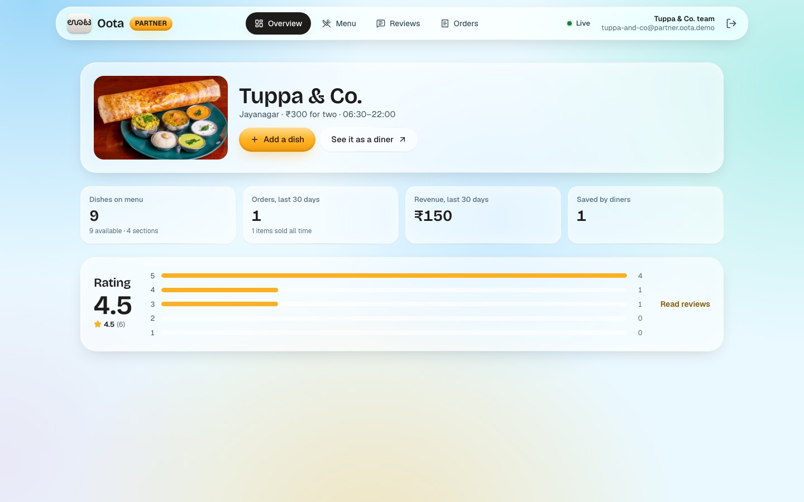
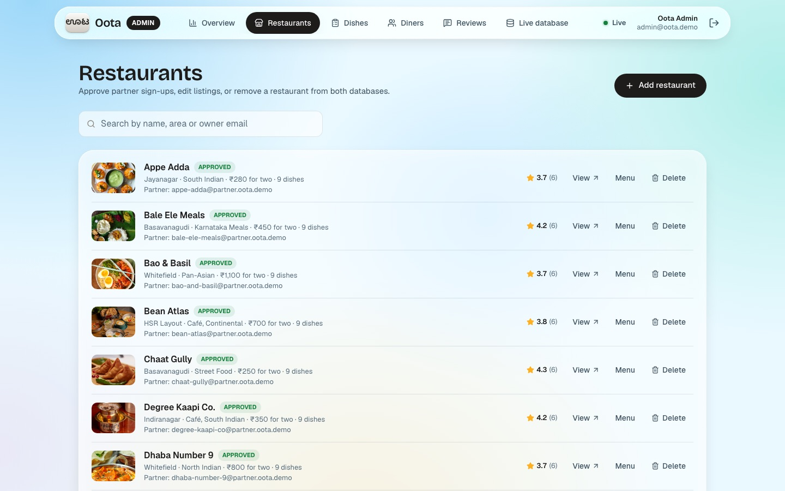
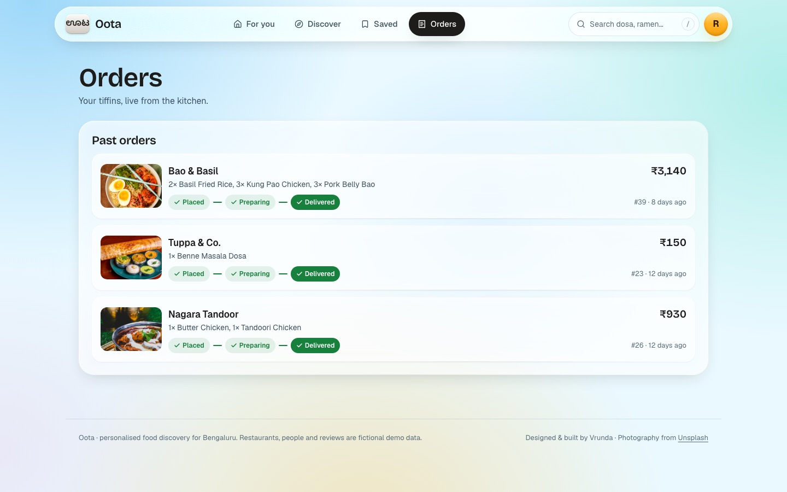

# Oota — DBMS report

*Vrunda · PES University DBMS mini-project · November 2026.* The designed, illustrated version of this report (with the live-demo script) is
**[Oota-DBMS-Explainer.pdf](Oota-DBMS-Explainer.pdf)**. Every output below was captured from the running, seeded databases.

## 1. The project
Oota is a personalised food discovery and ordering app for Bengaluru with three separate account types — **diners**, **restaurant partners** (the only
accounts that can list food; self sign-up, pending until approved) and **admins**. Diners get a different dashboard each, built from declared tastes,
searches (decaying by half every 7 days), their own ratings, taste fit and a Bayesian-smoothed rating; every pick shows its reasons.



## 2. Why two databases
| Data | Store | Why |
|---|---|---|
| users, admins, restaurant partners, restaurants, cuisines, menu sections, dishes, favourites, orders, order items | **PostgreSQL** | fixed shape, relations, constraints, transactions, joins, full-text search |
| preferences, reviews, search history, recently viewed | **MongoDB** | shape varies per user, append-heavy, read per user / per restaurant, aggregation pipelines, TTL |
| `avg_rating` / `review_count` | PostgreSQL **cache** of the Mongo aggregate | rating sort/filter in one indexed SQL query; recomputed idempotently (section 9) |

## 3. ER diagram — PostgreSQL


### Links into MongoDB (by id; enforced by the API)


## 4. Relational schema (3NF)
`users(user_id PK, full_name, email UK, password_hash, phone, city, created_at)` ·
`admins(admin_id PK, full_name, email UK, password_hash, created_at)` ·
`restaurant_owners(owner_id PK, restaurant_id FK UK → restaurants CASCADE, full_name, email UK, password_hash, created_at)` ·
`cuisines(cuisine_id PK, slug UK, name UK, image_url)` ·
`restaurants(restaurant_id PK, slug UK, name, description, address, area, city, phone, price_level 1–4, cost_for_two > 0, is_pure_veg, opens_at, closes_at, cover_url, gallery_urls[], avg_rating 0–5, review_count ≥ 0, trending_score 0–100, status ∈ pending/approved/rejected, created_at)` ·
`restaurant_cuisines(restaurant_id FK, cuisine_id FK, PK both)` ·
`menu_categories(category_id PK, restaurant_id FK, name, sort_order, UK(restaurant_id, name))` ·
`dishes(dish_id PK, restaurant_id FK, category_id FK, cuisine_id FK, name, description, price > 0, diet ∈ veg/egg/nonveg/vegan, spice_level 0–3, flavour_tags[], allergens[], image_url, is_available, avg_rating, review_count, created_at, search_vector)` ·
`favourite_restaurants(user_id FK, restaurant_id FK, saved_at, PK both)` ·
`orders(order_id PK, user_id FK CASCADE, restaurant_id FK RESTRICT, status ∈ PLACED/PREPARING/DELIVERED/CANCELLED, total_amount ≥ 0 (trigger), placed_at)` ·
`order_items(order_id FK CASCADE, dish_id FK RESTRICT, quantity 1–20, unit_price > 0, PK both)`.
Full DDL: [db/postgres/schema.sql](../db/postgres/schema.sql), [db/postgres/realtime.sql](../db/postgres/realtime.sql).

**Normalisation.** 1NF: multi-valued facts are separate tables (restaurant↔cuisine, saves, order lines); the small arrays `flavour_tags`, `allergens`,
`gallery_urls` are owned by one row, never joined, and queried atomically with `@>`/`&&` on a GIN index. 2NF: no attribute depends on part of a composite key.
3NF: no transitive dependencies (dishes store `restaurant_id`, not the restaurant's name/area; menu sections are their own table). Controlled exceptions:
`order_items.unit_price` (historical price — a fact about the order), `orders.total_amount` (trigger-maintained), `avg_rating` (cache of Mongo, section 9),
`price_level` (derived from `cost_for_two` by the API).

## 5. Triggers, functions, views, indexes
* `trg_dish_search_vector` (BEFORE INSERT/UPDATE): rebuilds the weighted tsvector (name A, description B).
* `trg_order_total` (AFTER INSERT/UPDATE/DELETE on `order_items`): keeps `orders.total_amount = Σ quantity × unit_price`.
* `trg_notify_*` (statement-level, every table) + event triggers `evt_notify_drop` / `evt_notify_ddl`: `pg_notify` → API → SSE → live UI.
* Views `v_restaurant_summary`, `v_popular_dishes`.
* Indexes: GIN on `search_vector` and `flavour_tags`; composite `orders(user_id, placed_at DESC)`; partial `restaurants(status) WHERE status <> 'approved'`; B-tree on rating, area and FK columns.

### EXPLAIN ANALYZE, 300,000 rows (`docs/index-demo.sql`)
```
QUERY PLAN                                           
------------------------------------------------------------------------------------------------
 Limit (actual time=4.003..4.794 rows=10 loops=1)
   ->  Gather Merge (actual time=4.003..4.792 rows=10 loops=1)
         Workers Planned: 1
         Workers Launched: 1
         ->  Sort (actual time=3.277..3.277 rows=8 loops=2)
               Sort Key: placed_at DESC
               Sort Method: top-N heapsort  Memory: 26kB
               Worker 0:  Sort Method: top-N heapsort  Memory: 26kB
               ->  Parallel Seq Scan on bench_orders (actual time=0.127..3.224 rows=31 loops=2)
                     Filter: (user_id = 42)
                     Rows Removed by Filter: 149969
 Planning Time: 0.091 ms
 Execution Time: 4.809 ms
(13 rows)
```
```
QUERY PLAN                                               
-------------------------------------------------------------------------------------------------------
 Limit (actual time=0.017..0.022 rows=10 loops=1)
   ->  Index Scan using idx_bench_user_time on bench_orders (actual time=0.017..0.020 rows=10 loops=1)
         Index Cond: (user_id = 42)
 Planning Time: 0.080 ms
 Execution Time: 0.029 ms
(5 rows)
```

## 6. Transaction with rollback (`docs/transaction-demo.sql`)
```
BEGIN;
BEGIN
INSERT INTO orders (user_id, restaurant_id) VALUES (2, 4) RETURNING order_id;
 order_id 
----------
       41
(1 row)

INSERT 0 1
INSERT INTO order_items (order_id, dish_id, quantity, unit_price)
  SELECT currval('orders_order_id_seq'), dish_id, 2, price FROM dishes WHERE dish_id = 28;
INSERT 0 1
INSERT INTO order_items (order_id, dish_id, quantity, unit_price)
  SELECT currval('orders_order_id_seq'), dish_id, 1, price FROM dishes WHERE dish_id = 29;
INSERT 0 1
SELECT order_id, total_amount FROM orders WHERE order_id = currval('orders_order_id_seq');
 order_id | total_amount 
----------+--------------
       41 |       920.00
(1 row)

COMMIT;
COMMIT
SELECT COUNT(*) AS orders_before FROM orders;
 orders_before 
---------------
            41
(1 row)

BEGIN;
BEGIN
INSERT INTO orders (user_id, restaurant_id) VALUES (2, 4);
INSERT 0 1
INSERT INTO order_items (order_id, dish_id, quantity, unit_price) SELECT currval('orders_order_id_seq'), 28, 1, 280;
INSERT 0 1
INSERT INTO order_items (order_id, dish_id, quantity, unit_price) SELECT currval('orders_order_id_seq'), 29, 99, 360;
COMMIT;
ROLLBACK
SELECT COUNT(*) AS orders_after FROM orders;
ERROR:  new row for relation "order_items" violates check constraint "order_items_quantity_check"
DETAIL:  Failing row contains (42, 29, 99, 360.00).
 orders_after 
--------------
           41
(1 row)

UPDATE order_items SET quantity = 3 WHERE order_id = (SELECT MAX(order_id) FROM orders) AND dish_id = 28;
UPDATE 1
SELECT order_id, total_amount FROM orders WHERE order_id = (SELECT MAX(order_id) FROM orders);
 order_id | total_amount 
----------+--------------
       41 |      1200.00
(1 row)

DELETE FROM orders WHERE order_id = (SELECT MAX(order_id) FROM orders);
DELETE 1

```

## 7. Queries (`docs/queries.sql`) — real output
```
SELECT r.name, r.area, string_agg(DISTINCT c.name, ', ') AS cuisines, COUNT(DISTINCT d.dish_id) AS dishes
FROM restaurants r
JOIN restaurant_cuisines rc ON rc.restaurant_id = r.restaurant_id
JOIN cuisines c ON c.cuisine_id = rc.cuisine_id
LEFT JOIN dishes d ON d.restaurant_id = r.restaurant_id
GROUP BY r.restaurant_id ORDER BY r.name LIMIT 6;
       name       |     area     |      cuisines      | dishes 
------------------+--------------+--------------------+--------
 Appe Adda        | Jayanagar    | South Indian       |      9
 Bale Ele Meals   | Basavanagudi | Karnataka Meals    |      9
 Bao & Basil      | Whitefield   | Pan-Asian          |      9
 Bean Atlas       | HSR Layout   | Café, Continental  |      9
 Chaat Gully      | Basavanagudi | Street Food        |      9
 Degree Kaapi Co. | Indiranagar  | Café, South Indian |      9
(6 rows)

SELECT area, COUNT(*) AS restaurants, ROUND(AVG(avg_rating), 2) AS avg_rating
FROM restaurants WHERE status = 'approved'
GROUP BY area HAVING COUNT(*) >= 3 ORDER BY avg_rating DESC;
    area     | restaurants | avg_rating 
-------------+-------------+------------
 Koramangala |           5 |       4.30
 Indiranagar |           5 |       4.20
 HSR Layout  |           3 |       3.83
 Whitefield  |           3 |       3.80
(4 rows)

SELECT restaurant, dish, avg_rating FROM (
  SELECT r.name AS restaurant, d.name AS dish, d.avg_rating,
         RANK() OVER (PARTITION BY d.restaurant_id ORDER BY d.avg_rating DESC, d.review_count DESC) AS rnk
  FROM dishes d JOIN restaurants r ON r.restaurant_id = d.restaurant_id
) t WHERE rnk = 1 ORDER BY avg_rating DESC, restaurant LIMIT 8;
   restaurant   |       dish        | avg_rating 
----------------+-------------------+------------
 Appe Adda      | Green Chutney Jar |        5.0
 Appe Adda      | Ragi Paddu        |        5.0
 Appe Adda      | Sweet Banana Appe |        5.0
 Bale Ele Meals | Obbattu (Holige)  |        5.0
 Bale Ele Meals | Akki Rotti        |        5.0
 Bale Ele Meals | Paal Payasa       |        5.0
 Bale Ele Meals | Mysore Saaru      |        5.0
 Bao & Basil    | Pork Belly Bao    |        5.0
(8 rows)

WITH rev AS (
  SELECT restaurant_id, SUM(total_amount) AS revenue, COUNT(*) AS orders
  FROM orders WHERE status <> 'CANCELLED' GROUP BY restaurant_id
)
SELECT r.name, rev.orders, rev.revenue,
       ROUND(100.0 * rev.revenue / SUM(rev.revenue) OVER (), 1) AS pct_of_total
FROM rev JOIN restaurants r USING (restaurant_id)
ORDER BY rev.revenue DESC LIMIT 6;
       name       | orders | revenue | pct_of_total 
------------------+--------+---------+--------------
 Ginza Noodle Bar |      3 | 6520.00 |         18.3
 Mangala Coast    |      4 | 6280.00 |         17.6
 Bao & Basil      |      2 | 4160.00 |         11.7
 Sweet Shed       |      2 | 2180.00 |          6.1
 Saaru & Sons     |      4 | 2170.00 |          6.1
 Dhaba Number 9   |      3 | 2140.00 |          6.0
(6 rows)

SELECT r.name AS restaurant, d.name AS dish, d.price
FROM dishes d JOIN restaurants r ON r.restaurant_id = d.restaurant_id
WHERE d.price > (SELECT AVG(d2.price) FROM dishes d2 WHERE d2.restaurant_id = d.restaurant_id)
ORDER BY d.price DESC LIMIT 6;
    restaurant    |       dish       | price  
------------------+------------------+--------
 Forno Verde      | Funghi e Tartufo | 640.00
 Forno Verde      | Diavola          | 620.00
 Trattoria Ulsoor | Quattro Formaggi | 620.00
 Ginza Noodle Bar | Tonkotsu Ramen   | 620.00
 Ginza Noodle Bar | Tantanmen        | 600.00
 Trattoria Ulsoor | Lasagne al Forno | 580.00
(6 rows)

SELECT d.name, r.name AS restaurant, ROUND(ts_rank(d.search_vector, q)::numeric, 3) AS rank
FROM dishes d JOIN restaurants r ON r.restaurant_id = d.restaurant_id,
     websearch_to_tsquery('english', 'ghee roast') q
WHERE d.search_vector @@ q ORDER BY rank DESC;
        name         |  restaurant   | rank  
---------------------+---------------+-------
 Mushroom Ghee Roast | Mangala Coast | 0.999
 Prawn Ghee Roast    | Mangala Coast | 0.998
 Ghee Roast Dosa     | Tuppa & Co.   | 0.997
(3 rows)

SELECT d.name, d.flavour_tags, d.diet FROM dishes d
WHERE d.flavour_tags @> ARRAY['spicy', 'crispy'] ORDER BY d.name LIMIT 8;
        name         |     flavour_tags      |  diet  
---------------------+-----------------------+--------
 Cheese Chilli Paddu | {crispy,creamy,spicy} | veg
 Chicken Kebab       | {spicy,crispy}        | nonveg
 Chilli Potato       | {spicy,crispy}        | vegan
 Ghee Podi Dosa      | {spicy,crispy,rich}   | veg
 Gobi 65             | {spicy,crispy}        | vegan
 Mango Thokku Fries  | {tangy,spicy,crispy}  | vegan
 Masala Paddu        | {spicy,crispy}        | vegan
 Masala Vada Pav     | {spicy,crispy}        | vegan
(8 rows)

SELECT COUNT(*) AS vegan_nut_free_dishes FROM dishes
WHERE is_available AND diet = ANY (ARRAY['vegan']) AND NOT (allergens && ARRAY['nuts']);
 vegan_nut_free_dishes 
-----------------------
                    58
(1 row)

SELECT name, area, cuisines, avg_rating, review_count, dish_count
FROM v_restaurant_summary ORDER BY avg_rating DESC, review_count DESC LIMIT 5;
       name        |    area     |      cuisines      | avg_rating | review_count | dish_count 
-------------------+-------------+--------------------+------------+--------------+------------
 Kebab Kothi       | Frazer Town | {Mughlai}          |        4.7 |            7 |          9
 Greenhouse 5      | Koramangala | {Café,Continental} |        4.5 |            6 |          9
 Tuppa & Co.       | Jayanagar   | {"South Indian"}   |        4.5 |            6 |          9
 Smash Yard        | Koramangala | {American}         |        4.4 |            7 |          9
 Hosa Biryani Mane | Koramangala | {Biryani}          |        4.3 |            7 |          9
(5 rows)

SELECT name, restaurant_name, times_ordered FROM v_popular_dishes ORDER BY times_ordered DESC, name LIMIT 6;
           name            | restaurant_name  | times_ordered 
---------------------------+------------------+---------------
 Mango Panna Cotta (Vegan) | Sweet Shed       |             6
 Basil Fried Rice          | Bao & Basil      |             5
 Kadle Manoli              | Mangala Coast    |             5
 Tandoori Roti             | Dhaba Number 9   |             5
 Ulavacharu                | Saaru & Sons     |             5
 Banana Bread              | Degree Kaapi Co. |             4
(6 rows)

SELECT r.name FROM restaurants r
WHERE NOT EXISTS (SELECT 1 FROM favourite_restaurants f WHERE f.restaurant_id = r.restaurant_id)
ORDER BY r.name LIMIT 8;
       name       
------------------
 Appe Adda
 Bale Ele Meals
 Bao & Basil
 Bean Atlas
 Chaat Gully
 Dhaba Number 9
 Ginza Noodle Bar
 Kempu Kitchen
(8 rows)

SELECT COUNT(*) AS orders_checked,
       COUNT(*) FILTER (WHERE o.total_amount = s.items_sum) AS totals_matching
FROM orders o JOIN (SELECT order_id, SUM(quantity * unit_price) AS items_sum FROM order_items GROUP BY order_id) s USING (order_id);
 orders_checked | totals_matching 
----------------+-----------------
             40 |              40
(1 row)

SELECT 'diners' AS account_type, COUNT(*) FROM users
UNION ALL SELECT 'restaurant partners', COUNT(*) FROM restaurant_owners
UNION ALL SELECT 'admins', COUNT(*) FROM admins;
    account_type     | count 
---------------------+-------
 diners              |    23
 restaurant partners |    24
 admins              |     1
(3 rows)

SELECT u.full_name, COUNT(DISTINCT o.restaurant_id) AS restaurants, SUM(o.total_amount) AS spent
FROM users u JOIN orders o ON o.user_id = u.user_id
GROUP BY u.user_id HAVING COUNT(DISTINCT o.restaurant_id) > 1
ORDER BY spent DESC LIMIT 5;
  full_name  | restaurants |  spent  
-------------+-------------+---------
 Sameer Khan |           6 | 4285.00
 Rohan Mehta |           3 | 4220.00
 Zoya Baig   |           2 | 3720.00
 Tanvi Joshi |           3 | 3510.00
 Karthik Rao |           2 | 3320.00
(5 rows)


```

## 8. MongoDB (`docs/mongo-demo.js`)
Collections: `reviews` (indexes `{restaurantId,createdAt}`, `{userId,createdAt}`, **unique** `{userId,restaurantId}`), `user_preferences` (`_id` = Postgres user_id),
`search_history` (`{userId,createdAt}` + **TTL 90 days**), `restaurant_views` (`{userId,viewedAt}`, latest 20 kept).
```
--- Pipeline 1: per-restaurant average, count and 1–5★ distribution ($group)

{"_id":1,"count":6,"r5":4,"r4":1,"r3":1,"r2":0,"r1":0,"avg":4.5}
{"_id":5,"count":6,"r5":2,"r4":3,"r3":0,"r2":1,"r1":0,"avg":4}
{"_id":9,"count":7,"r5":6,"r4":0,"r3":1,"r2":0,"r1":0,"avg":4.71}

--- Pipeline 2: a diner's favourite review tags ($unwind → $group → $sort)

{"_id":"Generous portions","count":3,"avgRating":4.33}
{"_id":"Worth the wait","count":2,"avgRating":5}
{"_id":"Authentic","count":1,"avgRating":5}
{"_id":"Loud","count":1,"avgRating":4}
{"_id":"Pricey","count":1,"avgRating":3}

--- Pipeline 3: per-dish rating from embedded dishRatings ($unwind of an array of sub-documents)

{"_id":28,"n":3,"avg":4.67}
{"_id":159,"n":3,"avg":4.67}
{"_id":46,"n":2,"avg":5}
{"_id":129,"n":2,"avg":5}
{"_id":79,"n":2,"avg":5}

--- Indexes on reviews

{"name":"_id_","key":{"_id":1},"unique":false}
{"name":"by_restaurant_recent","key":{"restaurantId":1,"createdAt":-1},"unique":false}
{"name":"by_user_recent","key":{"userId":1,"createdAt":-1},"unique":false}
{"name":"one_per_user_place","key":{"userId":1,"restaurantId":1},"unique":true}

--- TTL index on search_history

{"name":"ttl_90d","key":{"createdAt":1},"expireAfterSeconds":7776000}

--- explain(): reviews for one restaurant, newest first

{
 "plan": "FETCH → IXSCAN (by_restaurant_recent)",
 "docsExamined": 6,
 "keysExamined": 6,
 "returned": 6
}

--- Unique index enforces one review per diner per restaurant

rejected: E11000 duplicate key error collection: oota.reviews index: one_per_user_place
```

## 9. Review → rating sync (cross-database consistency)
`POST /api/restaurants/:id/reviews` → validate (and check the restaurant/dishes exist in Postgres) → **upsert into Mongo** → run the aggregation for that
restaurant and its rated dishes → `UPDATE restaurants/dishes SET avg_rating, review_count` in Postgres. Mongo first, Postgres second, and the second step
**recomputes** rather than increments, so it is idempotent: a failed step is repaired by re-running it (`npm run resync`). No distributed transaction —
the trade-off is a briefly stale rating, never a permanently wrong one. Deleting a diner (admin) removes their rows from both databases and re-syncs the
restaurants they reviewed.

## 10. Live demo
See section 14 of the PDF. In short: `docker exec -it oota-postgres psql -U oota -d oota`, then e.g. `INSERT INTO dishes …`, `UPDATE dishes SET price = 99 …`,
`DELETE …`, `UPDATE restaurants SET status = 'pending' …`, `DROP TABLE favourite_restaurants;` — the app updates within ~1 s; `cd backend && npm run reset` restores.

## 11. Screenshots
| Ananya | Rohan | Meera |
|---|---|---|
|  |  |  |
|  |  |  |
